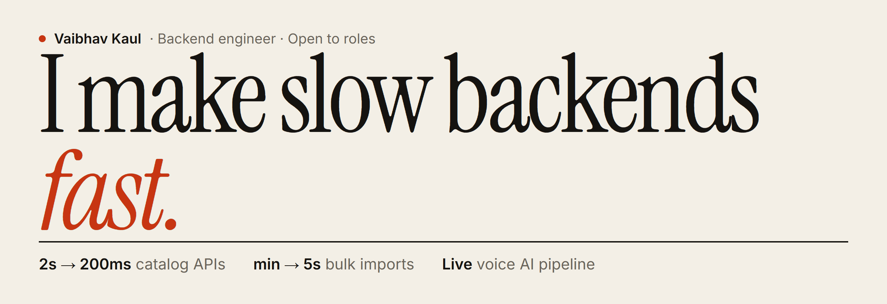

<a href="https://vaibhav-kaul.web.app">
  <picture>
    <source media="(prefers-color-scheme: dark)" srcset="./assets/banner-dark.png" />
    
  </picture>
</a>

### Backend engineer · Node.js, Python, PostgreSQL, AWS

I've spent 2+ years shipping delivery, e-commerce and real-time voice systems to production. Most of that code lives in private company repositories, so the evidence is summarised below and the full case studies, with architecture diagrams, are on my portfolio.

**[Portfolio](https://vaibhav-kaul.web.app)** · [LinkedIn](https://www.linkedin.com/in/vaibhav-kaul-448889246/) · [Resume](https://vaibhav-kaul.web.app/resume.pdf) · [Email](mailto:shivamkaul11@gmail.com)

## What I've shipped

| Result | Project | How |
| :--- | :--- | :--- |
| **~2s → ~200ms** catalog APIs, 10× faster | Easy Cater | Removed redundant database calls from the request path. No new infrastructure. |
| **Minutes → under 5s** bulk imports, ~90% less time | ProtectALL | Validated CSV ingestion feeding one warranty-pricing core for Shopify, BigCommerce and WooCommerce. |
| **Real-time voice** two-way, over WebSockets | VoiceNow | VAD → STT → LLM → TTS streaming pipeline, RAG on PGVector, and a TypeScript SDK on NPM. |
| **4 channels, 1 layer** | XUnified | WhatsApp, Facebook, Instagram and Telegram behind one channel layer, routed to GPT, Gemini or Dialogflow agents. |

## Now

Software Developer at **Easy Cater**: delivery backend, GIS routing, live driver tracking and the order state machine shared by the User, Merchant and Delivery apps.

## Side projects

- **[WebMemoir](https://chromewebstore.google.com/detail/webmemoir/kfipipfcamkmcghbbaendjaohmlnfcmc)**: a Chrome extension to capture and organise your web browsing memories.
- **[Customer data ingestion pipeline](https://github.com/SVK04/customer-data-ingestion-pipeline)**: Flask → FastAPI → PostgreSQL, with paginated fetching and idempotent upserts, all in Docker.
- **Society Sync**: a multi-tenant society management platform with role-based access and an immutable billing ledger.

## Stack

- **Backend:** Node.js · TypeScript · Python · FastAPI · Express · REST · WebSockets
- **Data:** PostgreSQL · PGVector · Redis · Prisma
- **Cloud:** AWS Lambda · API Gateway · S3 · RDS · EventBridge · Docker · GitHub Actions
- **AI:** LangChain · RAG · GPT-4o · Gemini · STT / TTS
- **Frontend:** React · Next.js · Tailwind CSS
